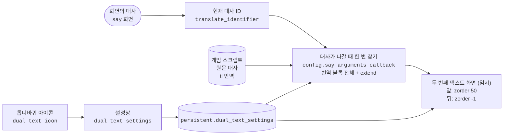

# Xeti's Dual Text Mode

[English](README.md) | **한국어**

대사마다 아래에 두 번째 텍스트를 보여 주는 Ren'Py 모드입니다. 같은 대사를 게임의 원문 스크립트나, 게임에 들어 있는 다른 번역에서 가져와 함께 보여 줍니다. 번역된 게임을 원문과 나란히 읽거나 언어 공부에 쓸 수 있습니다.

## 기능

- 게임은 지금 언어 그대로 두고, 현재 대사를 다른 언어(원문 스크립트 또는 게임에 들어 있는 번역)로 함께 보여 줍니다
- 오른쪽 위 톱니바퀴 아이콘으로 설정창을 엽니다:
  - 모드 켜기/끄기
  - 표시할 언어 (`원문` = 원래 스크립트, 또는 게임에 있는 언어). 게임이 이미 같은 언어로 보여 주고 있으면 두 번째 텍스트는 숨깁니다
  - 글자 크기, 줄 간격, 투명도, 색상 (색상 선택기)
  - 텍스트 위치: 게임 대사 줄 사이 (자동, 기본값) 또는 직접 지정 (상하 위치, 좌우 시작 위치, 너비)
  - 자동일 때 두 번째 텍스트 줄 위아래 간격, 두 번째 텍스트 줄을 칸 안에서 위아래로 옮기는 높이 미세 조정(글꼴마다 글자가 줄 칸 안에서 놓이는 위치가 달라 위아래 여백이 다르게 보일 때), 위치 다시 잡기 버튼. 글자 크기, 간격, 언어를 바꾸면 화면에 떠 있는 대사에 바로 다시 맞춥니다
  - 텍스트를 대사창 앞에 둘지 뒤에 둘지
  - 게임 원래 대사의 줄 간격
- 설정은 게임 persistent 데이터의 버전 번호가 붙은 dict 하나(`persistent.dual_text_settings`)에 저장되어 다시 켜도 유지됩니다. 위치와 너비는 화면 대비 비율로 저장합니다. 예전 버전 모드의 설정은 한 번 옮겨 옵니다

## 설치

1. `dual_text_mod.rpa`를 게임의 `game` 폴더에 넣습니다.
2. 게임을 실행하면 화면 오른쪽 위에 톱니바퀴 아이콘이 나타납니다.

Ren'Py 8 게임에서 동작합니다 (8.2.1, 8.3.2, 8.5.2, 8.5.3에서 확인). Ren'Py 7 게임은 지원하지 않습니다.

## `dual_text_mod.rpa` 안의 파일

| 파일 | 역할 |
|---|---|
| `dual_text_mod/dual_text_core.rpy` | 고른 언어의 대사 찾기, 화면에 그리기, 설정창 |
| `dual_text_mod/color_picker.rpy` | 색상 선택기 (Feniks의 [Color Picker for Ren'Py](https://github.com/shawna-p/renpy-color-picker) v1.4) |
| `dual_text_mod/Paperlogy-6SemiBold.ttf` | 두 번째 텍스트와 설정창 글꼴 |
| `dual_text_mod/setting_icon.png` | 톱니바퀴 아이콘 |

컴파일된 `.rpyc` 파일도 함께 들어 있습니다. Ren'Py는 아카이브 안에서는 `.rpyc`만 읽으므로, `.rpy`를 고치면 `.rpyc`를 다시 컴파일해야 바뀐 내용이 적용됩니다. 소스와 글꼴, 아이콘은 레포의 `dual_text_mod/` 폴더에 있습니다.

## 빌드

- `.rpyc`는 **지원하려는 가장 오래된 Ren'Py 8 버전으로** 컴파일합니다. 새 버전은 옛 `.rpyc`를 읽지만, 옛 버전은 새 `.rpyc`를 읽지 못해 게임이 `Could not load from archive` 오류로 실행되지 않습니다. (예: 8.5.3에서 컴파일하면 8.2.1 게임에서 실행되지 않음)
- 현재 `dual_text_mod.rpa`는 Ren'Py 8.2.1로 컴파일했고 8.2.1, 8.3.2, 8.5.2, 8.5.3에서 확인했습니다. Ren'Py 7은 지원하지 않습니다.
- `tools/build.py`는 `dual_text_mod/`를 임시 프로젝트에서 컴파일해 `dual_text_mod.rpa`로 묶습니다. 그다음 모든 `.rpy`가 그 소스로 컴파일된 `.rpyc`와 함께 들어 있는지 확인합니다. 게임의 `.exe`도 다른 프로젝트 폴더를 받을 수 있으므로, Ren'Py 8.2.1 SDK나 8.2.1 게임 실행 파일 어느 쪽이든 됩니다.

  ```bash
  python tools/build.py --renpy "C:/path/to/renpy-8.2.1/renpy.exe"
  ```

## 테스트

`tests/project`는 한국어 번역이 붙은 작은 게임입니다. 대사마다 확인할 경우가 하나씩 들어 있습니다. `extend`, 번역에서 둘로 나뉜 대사, 문자열 화자, 번역 속 대기 태그(`{w}`, `{p}`, `{fast}`), 두 줄로 넘어가는 긴 대사, 나레이션, `pause`입니다. Eternum처럼 `say` 화면이 대사 글자 크기를 직접 정합니다.

`tools/run_tests.py`는 매번 새 복사본에 모드를 넣고 소리 없이 이 게임을 진행하면서 모드가 보여 준 것을 검사합니다. 실행마다 게임 창이 잠깐 뜹니다. 지원하는 Ren'Py 버전마다 `--renpy`를 붙입니다.

```bash
python tools/run_tests.py --renpy "C:/path/to/renpy-8.2.1/renpy.exe" --renpy "C:/path/to/renpy-8.5.3/renpy.exe"
```

| 시나리오 | 검사하는 것 |
|---|---|
| `en_ko` | 게임 영어, 두 번째 텍스트 한국어: 대사마다 글, 줄 엇갈림, 그려진 원문으로 잰 줄 높이, 대사를 넘길 때 두 번째 텍스트가 움직이지 않는지, `pause` 동안 두 번째 텍스트가 남지 않는지 |
| `ko_en` | 게임 한국어, 두 번째 텍스트 원문으로 같은 검사 |
| `rollback` | `extend` 대사로 롤백해도 대사 전체가 보이는지 |
| `migrate` | 예전 버전이 저장한 설정이 `persistent.dual_text_settings`로 옮겨지는지 |
| `live` | 대사가 떠 있을 때 크기, 간격, 위치 방식을 바꾸면 바로 다시 맞추는지 |
| `offset` | 높이 미세 조정이 두 번째 텍스트만 옮기는지 |

`tests/project/game/script.rpy`의 대사를 바꾸면 `renpy.exe tests/project translate korean`으로 번역 식별자를 다시 만들고 한국어 대사를 옮겨 넣습니다.

## 구조



- 톱니바퀴 아이콘은 `config.overlay_screens`에 넣기 때문에, 게임의 화면 파일을 고치지 않아도 어떤 게임 위에나 나타납니다.
- 두 번째 텍스트 화면(앞, 뒤)은 Ren'Py가 `say` 화면을 띄우는 것처럼 대사가 나갈 때마다 임시(transient) 화면으로 띄웁니다. 대사와 같은 순간에 나타나고 사라지므로 `with dissolve` 같은 전환에서 둘이 함께 사라집니다. 지난 두 번째 텍스트만 남아 천천히 사라지지 않습니다.
- 두 번째 텍스트는 대사가 나가는 순간(`config.say_arguments_callback`)에 한 번 찾고, 오버레이는 그 결과만 읽습니다. 그 대사가 화면에 있는 동안에만 보입니다.
- 번역 블록 안의 대사를 모두 합칩니다. 번역에서 한 대사를 여러 줄로 나눠도 전부 보입니다. `extend` 대사에서는 원문처럼 두 번째 텍스트도 앞 대사에 이어 붙습니다.
- 두 번째 텍스트는 `say` 화면이 떠 있을 때만 그립니다.
- 두 번째 텍스트는 한 번에 보여 주므로 대사 진행 태그(`{w}`, `{p}`, `{nw}`, `{fast}`, `{done}`, `{clear}`)를 뺍니다. `{p}`는 빈칸으로 바꿉니다.
- 두 번째 텍스트는 문자열 번역 없이 그립니다(`renpy.substitute(..., translate=False)`). 그래서 "Hi!"처럼 짧은 원문이 게임의 `translate ... strings` 번역표 때문에 다시 게임 언어로 바뀌지 않습니다.
- 자동 위치에서는 원문 1줄, 두 번째 텍스트 1줄, 원문 2줄, 두 번째 텍스트 2줄 순서로 엇갈려 보입니다. 대사가 화면에 나가기 직전(`config.say_arguments_callback`, 게임이 이미 쓰는 콜백이 있으면 그 뒤에 이어서)에 그 대사의 원문 줄 간격을 두 번째 텍스트 한 줄만큼 넓힙니다. 그다음 두 번째 텍스트를 줄 단위로 잘라 원문 줄 아래에 하나씩 놓습니다. 두 번째 텍스트가 더 길어서 남는 줄은 마지막 줄 바로 아래에 이어 붙입니다.
- 줄 높이는 대사 스타일로 잽니다. 게임이 `say` 화면 안에서 대사 글자 크기를 따로 정하는 경우(예: Eternum의 글자 크기 설정)도 있어서, 대사가 그려진 뒤 실제 텍스트로 다시 재고 값이 다르면 그 자리에서 다시 맞춥니다.
- 대사(`say` 화면의 `what` 텍스트) 위치는 대사창 모양(화자 이름 유무)마다 기억해 두므로 대사를 넘겨도 두 번째 텍스트가 움직이지 않습니다. 설정의 "위치 다시 잡기"를 누르면 다시 찾습니다. 대사를 찾지 못하면 직접 지정 위치에 그립니다.
- 모드의 함수는 `dual_text_mod` 네임스페이스에 있고, 모드가 추가하는 화면·스타일·트랜스폼·이미지 이름은 모두 `dual_text_`로 시작해서 게임의 이름과 겹치지 않습니다.

## 한계

- NVL 모드에서는 표시되지 않습니다. `say` 화면이 떠 있을 때만 그리기 때문입니다.
- `extend` 대사로 바로 로드하거나 롤백하면 두 번째 텍스트의 앞부분은 그 직전에 나온 대사에서 가져옵니다. 원문 대사도 Ren'Py가 같은 방식으로 이어 붙입니다.
- 원본 대사 줄 간격 설정은 게임이 대사를 `say_dialogue` 스타일로 그릴 때만 적용됩니다.
- Ren'Py 내부 API(`translator.default_translates`, `translator.language_translates`, 자동 위치에 쓰는 렌더 트리 `renpy.display.render.screen_render`)를 읽기 때문에 이후 Ren'Py 버전에서 바뀔 수 있습니다.
- 자동 위치는 대사 높이를 두 배 가까이 쓰므로, 대사창이 작은 게임에서 긴 대사는 아래로 넘칠 수 있습니다.
- 자동 위치는 화자가 `Character`이거나 이름 문자열일 때(예: `$ mc = "Orion"` 뒤의 `mc "..."`)만 줄을 엇갈립니다. 그 밖의 화자는 두 번째 텍스트를 대사 아래에 한 덩어리로 놓습니다.

## 만든 사람 표기

- 색상 선택기: Feniks의 "Color Picker for Ren'Py" ([feniksdev.com](https://feniksdev.com)). 이 모드에서는 전역 이름 앞에 `dual_text_`를 붙였습니다.

## 라이선스

모드 자체 코드는 [MIT 라이선스](LICENSE)를 따릅니다. 색상 선택기와 Paperlogy 글꼴은 각 제작자의 조건을 따르며, [LICENSE](LICENSE)에 적어 두었습니다.
