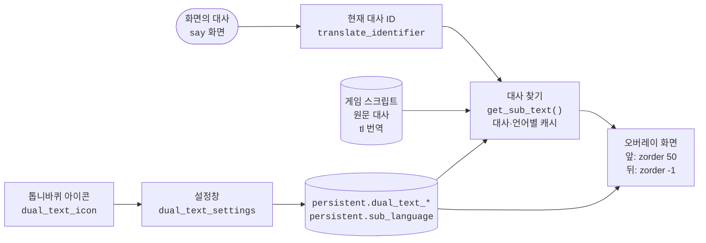

# Xeti's Dual Text Mode

[English](README.md) | **한국어**

대사마다 아래에 두 번째 텍스트를 보여 주는 Ren'Py 모드입니다. 같은 대사를 게임의 원문 스크립트나, 게임에 들어 있는 다른 번역에서 가져와 함께 보여 줍니다. 번역된 게임을 원문과 나란히 읽거나 언어 공부에 쓸 수 있습니다.

## 기능

- 게임은 지금 언어 그대로 두고, 현재 대사를 다른 언어(원문 스크립트 또는 게임에 들어 있는 번역)로 함께 보여 줍니다
- 오른쪽 위 톱니바퀴 아이콘으로 설정창을 엽니다:
  - 모드 켜기/끄기
  - 표시할 언어 (`원문` = 원래 스크립트, 또는 게임에 있는 언어)
  - 글자 크기, 줄 간격, 투명도, 색상 (색상 선택기)
  - 텍스트 상자의 상하 위치, 좌우 시작 위치, 너비
  - 텍스트를 대사창 앞에 둘지 뒤에 둘지
  - 게임 원래 대사의 줄 간격
- 설정은 게임의 persistent 데이터에 저장되어 다시 켜도 유지됩니다

## 설치

1. `dual_text_mod.rpa`를 게임의 `game` 폴더에 넣습니다.
2. 게임을 실행하면 화면 오른쪽 위에 톱니바퀴 아이콘이 나타납니다.

## `dual_text_mod.rpa` 안의 파일

| 파일 | 역할 |
|---|---|
| `dual_text_mod/dual_text_core.rpy` | 고른 언어의 대사 찾기, 화면에 그리기, 설정창 |
| `dual_text_mod/color_picker.rpy` | 색상 선택기 (Feniks의 [Color Picker for Ren'Py](https://github.com/shawna-p/renpy-color-picker) v1.4) |
| `dual_text_mod/Paperlogy-6SemiBold.ttf` | 두 번째 텍스트와 설정창 글꼴 |
| `dual_text_mod/setting_icon.png` | 톱니바퀴 아이콘 |

컴파일된 `.rpyc` 파일도 함께 들어 있습니다. Ren'Py는 아카이브 안에서는 `.rpyc`만 읽으므로, `.rpy`를 고치면 `.rpyc`를 다시 컴파일해야 바뀐 내용이 적용됩니다. 소스는 레포의 `dual_text_mod/` 폴더에 있습니다.

## 빌드

- `.rpyc`는 **지원하려는 가장 오래된 Ren'Py 8 버전으로** 컴파일합니다. 새 버전은 옛 `.rpyc`를 읽지만, 옛 버전은 새 `.rpyc`를 읽지 못해 게임이 `Could not load from archive` 오류로 실행되지 않습니다. (예: 8.5.3에서 컴파일하면 8.2.1 게임에서 실행되지 않음)
- 현재 `dual_text_mod.rpa`는 Ren'Py 8.2.1로 컴파일했고 8.2.1, 8.3.2, 8.5.2, 8.5.3에서 확인했습니다. Ren'Py 7은 지원하지 않습니다.

## 구조

- 세 화면(톱니바퀴 아이콘, 앞 오버레이, 뒤 오버레이)을 `config.overlay_screens`에 넣기 때문에, 게임의 화면 파일을 고치지 않아도 어떤 게임 위에나 나타납니다.
- 두 번째 텍스트는 `say` 화면이 떠 있을 때만 그립니다.

## 만든 사람 표기

- 색상 선택기: Feniks의 "Color Picker for Ren'Py" ([feniksdev.com](https://feniksdev.com))
