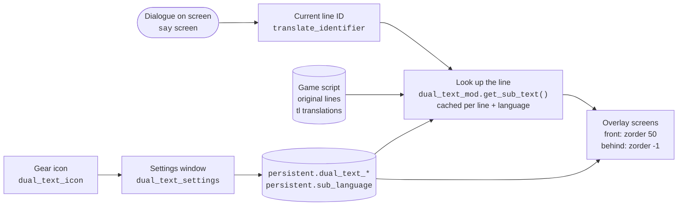

# Xeti's Dual Text Mode

**English** | [한국어](README.ko.md)

A Ren'Py mod that shows a second text under each line of dialogue: the same line from the game's original script, or from any translation the game ships with. You can read a translated game next to the original, or use it for language study.

## Features

- Shows the current line in another language (the original script or one of the game's translations) while the game keeps running in its own language
- A gear icon at the top right opens the settings window:
  - mode on/off
  - which language to show (`원문` = the original script, or one of the game's languages). The second text is hidden when it would repeat the language the game is already showing
  - font size, line spacing, opacity and color (with a color picker)
  - vertical position, horizontal start position and width of the text box
  - whether the text sits in front of or behind the dialogue box
  - line spacing of the game's own dialogue
- Settings are kept in the game's persistent data, so they survive restarts
- The settings window is in Korean

## Installation

1. Copy `dual_text_mod.rpa` into the game's `game` folder.
2. Start the game. A gear icon appears at the top right of the screen.

Works with Ren'Py 8 games (checked on 8.2.1, 8.3.2, 8.5.2 and 8.5.3). Ren'Py 7 games are not supported.

## What is inside `dual_text_mod.rpa`

| File | Role |
|---|---|
| `dual_text_mod/dual_text_core.rpy` | Finds the line in the chosen language, draws it, settings window |
| `dual_text_mod/color_picker.rpy` | Color picker ([Color Picker for Ren'Py](https://github.com/shawna-p/renpy-color-picker) v1.4 by Feniks) |
| `dual_text_mod/Paperlogy-6SemiBold.ttf` | Font for the second text and the settings window |
| `dual_text_mod/setting_icon.png` | Gear icon |

The archive also holds the compiled `.rpyc` files. Ren'Py reads only the `.rpyc` files from inside an archive, so after editing a `.rpy` file the `.rpyc` must be compiled again for the change to take effect. The sources are in the `dual_text_mod/` folder of this repository.

## Building

- Compile the `.rpyc` files with **the oldest Ren'Py 8 version you want to support**. Newer versions read older `.rpyc` files, but older versions cannot read newer ones and the game stops with `Could not load from archive` (for example, files compiled with 8.5.3 do not run in an 8.2.1 game).
- The current `dual_text_mod.rpa` was compiled with Ren'Py 8.2.1 and checked on 8.2.1, 8.3.2, 8.5.2 and 8.5.3. Ren'Py 7 is not supported.

## Structure

- The three screens (gear icon, front overlay, behind overlay) are added to `config.overlay_screens`, so they appear on top of any game without editing its screens.
- The second text is drawn only while the `say` screen is showing.
- The mod's functions live in the `dual_text_mod` namespace, and every screen, style, transform and image it adds starts with `dual_text_`, so they do not clash with the game's own names.

## Limitations

- Nothing is shown in NVL mode, because the mod only draws while the `say` screen is up.
- For an `extend` line, only the extended part is shown. If a translation splits one line into several, only the first is shown.
- The game's dialogue line spacing setting only works when the game draws dialogue with the `say_dialogue` style.
- The mod reads Ren'Py internals (`translator.default_translates`, `translator.language_translates`) that a future Ren'Py version may change.

## Credits

- Color picker: "Color Picker for Ren'Py" by Feniks ([feniksdev.com](https://feniksdev.com)). In this mod its global names carry a `dual_text_` prefix.

## License

The mod's own code is under the [MIT License](LICENSE). The color picker and the Paperlogy font keep their authors' terms; [LICENSE](LICENSE) lists them.
