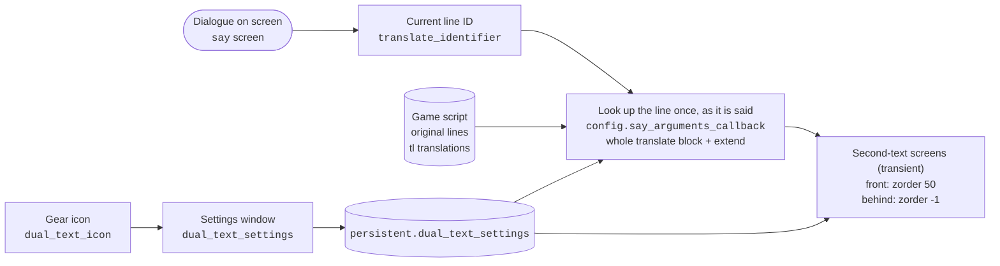

# Xeti's Dual Text Mode

**English** | [한국어](README.ko.md)

A Ren'Py mod that shows a second text under each line of dialogue: the same line from the game's original script, or from any translation the game ships with. You can read a translated game next to the original, or use it for language study.

## Features

- Shows the current line in another language (the original script or one of the game's translations) while the game keeps running in its own language
- A gear icon at the top right opens the settings window:
  - mode on/off
  - which language to show (`원문` = the original script, or one of the game's languages). The second text is hidden when it would repeat the language the game is already showing
  - font size, line spacing, opacity and color (with a color picker)
  - where the text goes: between the lines of the game's dialogue (automatic, the default) or at a position you set (vertical position, horizontal start position and width)
  - in automatic mode, the gap above and below each second-text line, a fine height adjustment that moves the second-text lines up or down inside their slot (fonts sit differently in their line box, so the gaps above and below can look uneven), and a button to find the position again. Changing the font size, the gap or the language re-fits the line on screen right away
  - whether the text sits in front of or behind the dialogue box
  - line spacing of the game's own dialogue
- Settings are kept in one versioned dict in the game's persistent data (`persistent.dual_text_settings`), so they survive restarts. Positions and widths are stored as fractions of the screen. Settings from older versions of the mod are moved over once
- The settings window is in Korean

## Installation

1. Copy `dual_text_mod.rpa` into the game's `game` folder.
2. Start the game. A gear icon appears at the top right of the screen.

Works with Ren'Py 8 games (checked on 8.2.1, 8.3.2, 8.5.2 and 8.5.3). Ren'Py 7 games are not supported.

## What is inside `dual_text_mod.rpa`

| File | Role |
|---|---|
| `dual_text_mod/dual_text_core.rpy` | Finds the line in the chosen language, draws it, settings window |
| `dual_text_mod/color_picker.rpy` | Color picker ([Color Picker for Ren'Py](https://github.com/shawna-p/renpy-color-picker) v1.4 by Feniks) |
| `dual_text_mod/Paperlogy-6SemiBold.ttf` | Font for the second text and the settings window |
| `dual_text_mod/setting_icon.png` | Gear icon |

The archive also holds the compiled `.rpyc` files. Ren'Py reads only the `.rpyc` files from inside an archive, so after editing a `.rpy` file the `.rpyc` must be compiled again for the change to take effect. The sources, the font and the icon are in the `dual_text_mod/` folder of this repository.

## Building

- Compile the `.rpyc` files with **the oldest Ren'Py 8 version you want to support**. Newer versions read older `.rpyc` files, but older versions cannot read newer ones and the game stops with `Could not load from archive` (for example, files compiled with 8.5.3 do not run in an 8.2.1 game).
- The current `dual_text_mod.rpa` was compiled with Ren'Py 8.2.1 and checked on 8.2.1, 8.3.2, 8.5.2 and 8.5.3. Ren'Py 7 is not supported.
- `tools/build.py` compiles `dual_text_mod/` in a temporary project, packs `dual_text_mod.rpa` and checks that every `.rpy` is inside together with a `.rpyc` compiled from exactly that source. Any Ren'Py 8.2.1 SDK or game executable works, because a game's `.exe` accepts another project folder:

  ```bash
  python tools/build.py --renpy "C:/path/to/renpy-8.2.1/renpy.exe"
  ```

## Testing

`tests/project` is a small game with a Korean translation. Each line covers one case: `extend`, a line the translator split in two, a speaker given as a plain string, pacing tags (`{w}`, `{p}`, `{fast}`) in the translation, a line long enough to wrap, a narrator line and a `pause`. Like Eternum, its `say` screen sets the dialogue size itself.

`tools/run_tests.py` plays it with the mod in fresh copies, with sound off, and checks what the mod shows. The game window opens briefly for each run. Repeat `--renpy` for every Ren'Py version you support:

```bash
python tools/run_tests.py --renpy "C:/path/to/renpy-8.2.1/renpy.exe" --renpy "C:/path/to/renpy-8.5.3/renpy.exe"
```

| Scenario | What it checks |
|---|---|
| `en_ko` | Game in English, Korean second text: the text of every line, interleaving, line height measured from the drawn dialogue, the second text not moving when you advance, no second text left during the `pause` |
| `ko_en` | The same with the game in Korean and the original script as the second text |
| `rollback` | Rolling back onto an `extend` line still shows the whole line |
| `migrate` | Settings saved by older versions are moved into `persistent.dual_text_settings` |
| `live` | Changing size, gap and position mode while a line is shown re-fits it right away |
| `offset` | The fine height adjustment moves only the second text |

If you change a line in `tests/project/game/script.rpy`, regenerate its translation identifiers with `renpy.exe tests/project translate korean` and copy the Korean lines over.

## Structure



- The gear icon is added to `config.overlay_screens`, so it appears on top of any game without editing its screens.
- The second-text screens (front and behind) are shown as transient screens each time a line is said, just like Ren'Py shows the `say` screen. They appear and disappear at the same moment as the dialogue, so a transition such as `with dissolve` fades both together instead of leaving the old second text on screen while it fades.
- The second text is looked up once, when the line is said (`config.say_arguments_callback`), and the overlay only reads that result. It is shown only while that same line is on screen.
- All lines in a translate block are joined, so a line a translator split into several is shown whole. For an `extend` line, the second text continues the line before it, just as the dialogue does.
- The second text is drawn only while the `say` screen is showing.
- Pacing tags (`{w}`, `{p}`, `{nw}`, `{fast}`, `{done}`, `{clear}`) are removed from the second text, which is shown all at once. `{p}` becomes a space.
- The second text is drawn without string translation (`renpy.substitute(..., translate=False)`), so a short original line such as "Hi!" is not turned back into the game's language by the game's `translate ... strings` table.
- In automatic mode the lines alternate: dialogue line 1, second-text line 1, dialogue line 2, second-text line 2, and so on. Just before each line is shown (`config.say_arguments_callback`, chained after any callback the game already set), the mod widens that line's dialogue line spacing by one second-text line. It then cuts the second text into lines and puts each one under the matching dialogue line. Lines left over when the second text is longer follow right under the last one.
- Line heights are measured with the dialogue's style. Some games set the dialogue size inside the `say` screen (Eternum, for example, uses its own text size setting), so once the dialogue is drawn the mod measures the drawn text again and re-fits the line if the numbers differ.
- The position of the dialogue (the `what` text of the `say` screen) is remembered for each dialogue box shape (with or without a speaker name), so the second text does not move when you advance. "Find position again" in the settings looks for it again. If the dialogue cannot be found, the position you set is used.
- The mod's functions live in the `dual_text_mod` namespace, and every screen, style, transform and image it adds starts with `dual_text_`, so they do not clash with the game's own names.

## Limitations

- Nothing is shown in NVL mode, because the mod only draws while the `say` screen is up.
- If the game is loaded or rolled back straight onto an `extend` line, the earlier part of the second text comes from the line said before it, as Ren'Py does for the dialogue itself.
- The game's dialogue line spacing setting only works when the game draws dialogue with the `say_dialogue` style.
- The mod reads Ren'Py internals (`translator.default_translates`, `translator.language_translates`, and the render tree in `renpy.display.render.screen_render` for automatic placement) that a future Ren'Py version may change.
- Because automatic mode makes the dialogue twice as tall, long lines may run past the bottom of a small dialogue box.
- Automatic mode needs the speaker to be a `Character` or a plain name string (as in `$ mc = "Orion"` followed by `mc "..."`). For other speakers the second text goes under the dialogue as one block.

## Credits

- Color picker: "Color Picker for Ren'Py" by Feniks ([feniksdev.com](https://feniksdev.com)). In this mod its global names carry a `dual_text_` prefix.

## License

The mod's own code is under the [MIT License](LICENSE). The color picker and the Paperlogy font keep their authors' terms; [LICENSE](LICENSE) lists them.
